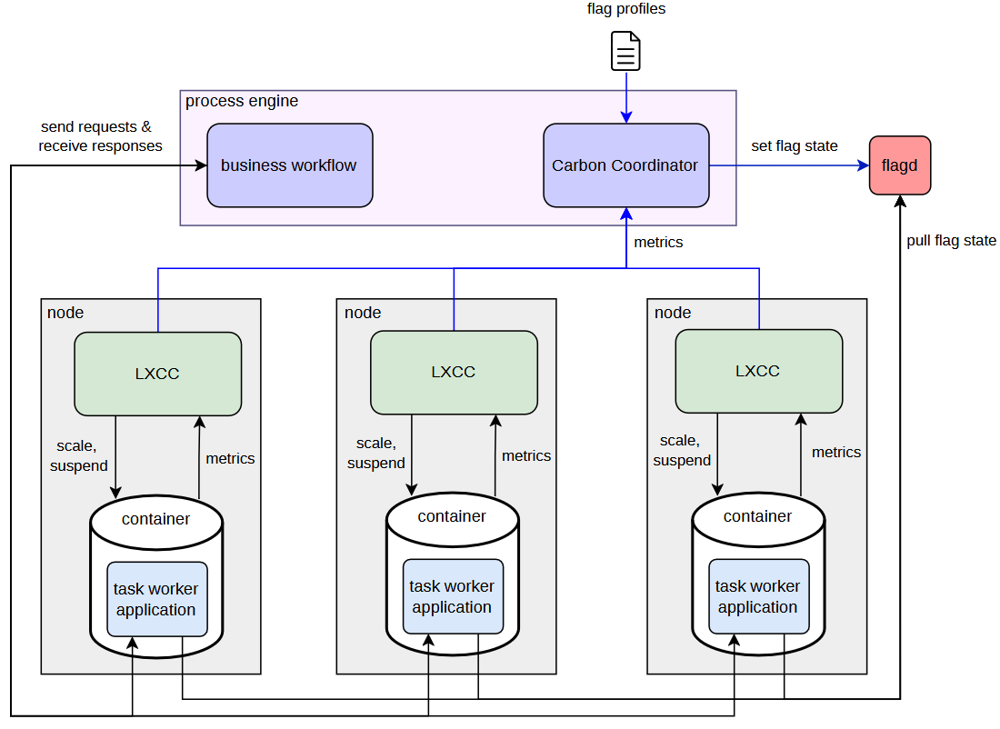

# Carbon-Aware Process Execution: Enhancing Process Runtimes with System- and Application-Layer Carbon Reduction Mechanisms

This repository contains the prototype developed for the bachelor thesis *Carbon-Aware Process Execution: Enhancing Process Runtimes with System- and Application-Layer Carbon Reduction Mechanisms*. It combines LXCC-based container-level carbon enforcment with a Temporal-based Carbon Coordinator that degrades application feature flags through flagd when carbon pressure exceeds a configured threshold or local task worker performance requieres interventions. The prototype was evaluated with synthetic business workflows under multiple load and carbon-intensity scenarios; the repository provides the implementation, experiment orchestration, configurations, and analysis scripts. It requiers a specific execution envoirment and recalibrations before use on another system.


---

## Contents

1. [Architecture](#architecture)
2. [Repository structure](#repository-structure)
3. [Requirements](#requirements)
4. [Installation](#installation)
5. [Configuration](#configuration)
6. [Start](#start)

---
## Architecture

<p align="center">

</p>

## Repository structure

```
.
├── .gitignore
├── ServerInfo.md
├── README.md
├── CarbonContainers/           # LXCC system-level carbon enforcment
│   ├── requirements.txt
│   └── code/
│       ├── cc-client.py
│       ├── cc-controller.py
│       ├── cc-front.py
│       ├── cc-monitor.py
│       ├── cc-records.py
│       ├── config.py
│       ├── daemon3x.py
│       ├── energy_accumulator.py
│       ├── metrics_server.py
│       ├── *.proto
│       ├── *_pb2.py
│       ├── *_pb2.pyi
│       ├── *_pb2_grpc.py
│       ├── *.json
│       ├── procMonitor.out
│       └── logs/
├── business_process/           # Business workflow, compute microservice and locust load generation
│   ├── calculate_compute_units.py
│   ├── calculate_rps_limit.py
│   ├── compute.py
│   ├── config.py
│   ├── default_flags.json
│   ├── flags.json
│   ├── load_shapes.pdf
│   ├── locust_shapes.py
│   ├── locustfile.py
│   ├── metrics_server.py
│   ├── request.py
│   ├── start_worker.py
│   └── workflow.py
├── carbon_coordinator/         # CarbonCoordinator for process-layer coordinated feature flag degradation 
│   ├── __init__.py
│   ├── analyze.py
│   ├── config.py
│   ├── execute.py
│   ├── flag_config.yaml
│   ├── helpers.py
│   ├── metrics_server.py
│   ├── model.py
│   ├── plan.py
│   ├── start_worker.py
│   ├── start_workflow.py
│   └── workflow.py
├── analysis/                  # Analysis scripts for creating tables and figures
│   ├── plot_run_csvs.py
│   ├── run_data.py
│   └── summarize_run_csvs.py
├── sma/                       # SMA run automation, parameter sweeps and monitoring 
│   ├── carbon_p75.py
│   ├── config.yaml
│   ├── main.py
│   ├── parameter_config.yaml
│   ├── parameter_sweep.py
│   ├── per-container-dashboard.json
│   ├── process-dashboard.json
│   ├── prometheus.yaml
└── reports/                   # Generated Data, Tables and Figures
   └── 20260922_015850_081cbd/
      └── analysis/

```


## Requirements

- LXCC's scaling requires symmetric SMT (e.g., 8 cores and 16 threads).
- Scaphandre requiers RAPL access so no VM support. 
- Testet on Ubuntu 24.04 Noble and developed in Python 3.14.4.
- The hardware specifications used for the evaluation are listed in ServerInfo.md.
- Container thresholds and compute service calibration should be performed, but are not requierd for an exemplary execution.


## Installation

1. LXCC
   ```bash
   sudo apt install lxc=1:6.0.6-1ubuntu1
   sudo apt install linux-tools-common=7.0.0-43.43
   sudo apt install scaphandre=1.0.2-10
   ```
2. flagd
   ```bash
   wget https://github.com/open-feature/flagd/releases/download/flagd%2Fv0.15.5/flagd_0.15.5_Linux_x86_64.tar.gz
   tar -xvzf flagd_0.15.5_Linux_x86_64.tar.gz
   sudo mv ./flagd_linux_x86_64 /usr/local/bin/flagd
   sudo chmod +x /usr/local/bin/flagd
   ```
3. Temporal
   ```bash
   wget https://github.com/temporalio/cli/releases/download/v1.7.0/temporal_cli_1.7.0_linux_amd64.tar.gz
   tar -xvzf temporal_cli_1.7.0_linux_amd64.tar.gz
   sudo mv temporal /usr/local/bin/
   sudo chmod +x /usr/local/bin/temporal
   ```
4. Prometheus
   ```bash
   wget https://github.com/prometheus/prometheus/releases/download/v3.4.0/prometheus-3.4.0.linux-amd64.tar.gz
   tar -xvzf prometheus-3.4.0.linux-amd64.tar.gz
   sudo mv prometheus-3.4.0.linux-amd64/prometheus /usr/local/bin/
   sudo chmod +x /usr/local/bin/prometheus
   ```
5. Grafana (optional)
   ```bash
   wget https://dl.grafana.com/oss/release/grafana_13.1.0_amd64.deb
   sudo apt install ./grafana_13.1.0_amd64.deb
   ```
   Import `sma/per-container-dashboard.json` and `sma/process-dashboard.json` and select Prometheus `http://localhost:9090` as the data source.
   Uncomment the line: `start_proc(“grafana”, [“sudo”, ‘grafana’, “server”])` in `sma/main.py`.
   

6. Python packages
   ```bash
   pip install -r requirements.txt
   ```


## Configuration

All settings that **must** or **can** be adjusted before the first startup are listed below.

The current setup uses two containers (`cont1`, `cont2`) to allow for a simpler execution. The experiments were carried out using four containers, the code for `cont3`, `cont4` is present but commented out in several files and must be enabled consistently. To reproduce the experiments, the containers, the configurations in `parameter_config.yaml` must be uncommented (currently only one configuration active), the `compute.py` service needs to be configured and the P75 LXCC thresholds need to be determined based on the baseline x scenario runs.   

| Configuration area | File or location | What to configure |
| --- | --- | --- |
| Python environment (must) | `sma/main.py` | Set `VENV` to the absolute path of the host Python virtual environment, including `/bin/`. |
| Repository path for flagd (must) | `sma/main.py` and `carbon_coordinator/flag_config.yaml` | Set `FLAGD_FLAGS_URI` and each `filepath` entry to the absolute path of `business_process/flags.json`. |
| LXC CPU allocation (must) | `/var/lib/lxc/<container-name>/config` | Assign dedicated CPU cores to every container. LXCC assumes symmetric SMT sibling pairs. |
| Host hardware model (must) | `CarbonContainers/code/config.py` | Adjust `MIGRATION_MACHINES` to the container's available logical CPUs, the hosts physical core count. Memory, and base power can be ignored. |
| Active containers (can) | `sma/main.py`, `business_process/config.py`, `carbon_coordinator/flag_config.yaml` | Keep `LXC_CONTAINERS`, `COMPUTE_SERVICES`, container names, timeouts, and coordinator configuration consistent. |
| Feature flags (can) | `business_process/flags.json`, `business_process/default_flags.json`, `carbon_coordinator/flag_config.yaml`, `sma/main.py` | Flag names and values must be consistent. |
| LXCC thresholds (can) | `sma/main.py` | Calibrate and update `LXCC_THRESHOLDS` for every used carbon-intensity region and load scenario. Thresholds are hardware- and workload-specific. |
| Carbon scenarios (can) | `sma/parameter_config.yaml`, `CarbonContainers/code/ci_*.json` | Select the region and ensure that a matching carbon-intensity dataset exists. |
| Carbon Coordinator policy (can) | `sma/parameter_config.yaml`, `carbon_coordinator/config.py` | Configure the score method, degradation threshold, and coordinator update interval. |
| Workload scenarios (can) | `sma/parameter_config.yaml`, `business_process/locust_shapes.py` | Select `steady`, `fluctuation`, or `spike`. Scenario names must match in both files. |
| Experiment duration (can) | `sma/config.yaml` | Set `observation.max_duration`. A experiment run can be ended by pressing Enter, the entiere Experiment can be ended by using Ctrl + C while running `sma/main.py`. |
| Number of repetitions (can) | `sma/main.py` | Set `NUM_SIMULATION_RUNS` to the desired number of repetitions per parameter combination. |
| Compute-service workload (can) | `business_process/compute.py` | Adjust `COMPUTE_UNITS`, concurrency limits, and queue size based on `calculate_compute_units.py` and `calculate_rps_limit.py`. |
| LXC network address (can) | `business_process/compute.py` | Set `FLAGD_HOST` to the host address reachable from the LXC containers. The default `10.0.3.1` assumes the standard LXC bridge configuration. |
| Ports and monitoring (can) | `sma/prometheus.yaml`, `sma/config.yaml`, `CarbonContainers/code/config.py`, `carbon_coordinator/config.py`, `business_process/config.py` | Keep Prometheus scrape targets and service ports consistent. |
| Update intervals (can) | `carbon_coordinator/config.py`, `CarbonContainers/code/config.py`, `sma/config.yaml` | LXCC's, the Carbon Coordinators and the sma Intervals can be adapted. All are currently set to 10s.

### LXC container setup

Create one Ubuntu container for every active compute service:

```bash
sudo lxc-create -n <container-name> -t download -- -d ubuntu -r noble -a amd64
```

Add a dedicated CPU allocation to `/var/lib/lxc/<container-name>/config`:

```text
lxc.cgroup2.cpuset.cpus = <start-core-smt1>-<end-core-smt1>,<start-core-smt2>-<end-core-smt2>
```

For example, on an 8-core / 16-thread system:

```text
# cont1
lxc.cgroup2.cpuset.cpus = 0-1,8-9

# cont2
lxc.cgroup2.cpuset.cpus = 2-3,10-11
```

### Compute-service setup

Before the first experiment, copy the compute service into every active container and install its dependencies:

```bash
sudo cp business_process/compute.py /var/lib/lxc/<container-name>/rootfs/root/compute.py

sudo lxc-start -n <container-name>
sudo lxc-attach -n <container-name> -- bash -lc 'apt-get update'
sudo lxc-attach -n <container-name> -- bash -lc 'apt-get install -y python3-pip python3.12-venv'
sudo lxc-attach -n <container-name> -- bash -lc 'python3 -m venv /venv'
sudo lxc-attach -n <container-name> -- bash -lc '/venv/bin/pip install fastapi uvicorn numpy openfeature-sdk openfeature-provider-flagd'
sudo lxc-stop -n <container-name>
```

The default orchestration in `sma/main.py` expects the container virtual environment at `/venv`. If another location is used, update the compute-service start command in `run_compute_services()` accordingly.


## Start

```bash
cd sma

sudo </absolute/path/to/venv/bin/python> main.py
```

Each experiment run is first saved to `sma/runs` and later grouped in `reports/<report-id>`.
The full experiment runs take ca. 81 hours (54 configurations x 3 runs x 30min per run).  
Due to the size of the folders, the raw data for this thesis is not stored in this repository, but only in the tub cloud.

To view the Grafana dashboards of previous runs, start Grafana, start prometheus with the old data and select the corresponding time frame inside the Grafana dashboards:
```bash
cd sma

prometheus --config.file=prometheus.yaml \
  --storage.tsdb.path=<path>/CarbonContainersThesis/sma/reports/<report-id>/<configuraion>/<run-id>/prometheus_data
```

